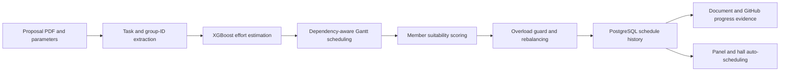

# ICDMIS 2026 Group Poster – Component Data Collection

## A. Group / Author Information

- **Full name:** [Confirm full name]
- **Student ID:** IT22117014
- **Exact name to appear on poster:** [Confirm poster name]
- **Department / Faculty:** Faculty of Computing
- **University:** Sri Lanka Institute of Information Technology (SLIIT) [Confirm official affiliation wording]
- **Email:** [Confirm email or omit]
- **Research component title:** Generative Project Planning and Adaptive Scheduling

---

## B. Component Summary

### 1. Component Name

**Generative Project Planning and Adaptive Scheduling with Evidence-Based Progress Tracking**

### 2. Problem Addressed

Academic software-project schedules are often created manually from lengthy proposals, producing subjective effort estimates, uneven workload allocation, and avoidable scheduling conflicts. Progress reports can also become unreliable when they depend only on self-reported percentages. This component supports students, supervisors, and academic staff by automating project planning, workload balancing, evidence-based progress tracking, and Proposal/PP1/PP2/Viva scheduling.

### 3. Component Objective

**Main objective:** Develop an intelligent scheduling component that converts project proposals into dependency-aware plans, balances tasks among team members, verifies progress from submitted documents and GitHub activity, and schedules academic evaluation events under staff and hall constraints.

**Supporting objectives:**

1. Estimate effort and generate a dependency-aware Gantt schedule from proposal evidence.
2. Allocate work fairly using learned task-member suitability and explicit overload safeguards.
3. Generate conflict-free Proposal, PP1, PP2, and Viva schedules with expertise-matched panels.

---

## C. Inputs, Methodology and Outputs

### 4. Inputs

- Project proposal PDF/text, group ID, start date, team size, expected duration, and function points.
- Extracted tasks, task categories, complexity, effort estimates, and dependency relationships.
- Team-member IDs, historical completion rate, current workload, and average task effort.
- Supervisor names, roles, expertise, available dates/times, and hall availability/capacity.
- Document submissions, supervisor review decisions, GitHub commits, pull requests, and signed webhook events.

### 5. Core Methods and Intelligence

#### Method / Model 1

- **Name:** Evidence-based PDF/WBS extraction with optional T5 fallback.
- **Purpose:** Extracts group IDs and actionable tasks from proposal sections. The large local T5 model is optional and disabled by default; deterministic proposal evidence is the operational path.

#### Method / Model 2

- **Name:** XGBoost effort regressor.
- **Purpose:** Predicts total project effort from function points and distributes it across tasks using task-type and complexity weights.

#### Method / Model 3

- **Name:** Dependency-aware DAG scheduling.
- **Purpose:** Validates task dependencies, rejects cycles, performs topological ordering, and calculates feasible working-day start/end dates while respecting predecessor and capacity constraints.

#### Method / Model 4

- **Name:** XGBoost task-completion classifier with LPT fallback.
- **Purpose:** Scores every task-member combination using task effort/category/complexity and member history. LPT assigns the longest remaining work to the least-loaded member if the model is unavailable.

#### Method / Model 5

- **Name:** Overload guard, whole-task rebalancing, and coefficient of variation (CV).
- **Purpose:** Overrides assignments exceeding the 1.40 max/min workload threshold, moves eligible tasks only when the final objective improves, and quantifies workload fairness using `CV = standard deviation / mean × 100`.

#### Method / Model 6

- **Name:** Monte Carlo simulation and NSGA-II multi-objective optimization.
- **Purpose:** Monte Carlo runs 1,000 counterfactual schedule simulations. NSGA-II searches trade-offs among duration, workload variance/burnout, and milestone visibility.

#### Method / Model 7

- **Name:** Expertise similarity and constraint-based academic scheduling.
- **Purpose:** Uses MiniLM embeddings when enabled, or TF-IDF cosine similarity locally, to rank supervisors by topic expertise. Role, availability, overlap, panel-load, hall, and event-week constraints are then enforced.

#### Method / Model 8

- **Name:** Evidence-based progress calculation.
- **Purpose:** Connects tasks to document submissions and GitHub events. Commits provide activity evidence but do not automatically prove completion; supervisors approve or reject submitted documents.

### 6. Component Workflow

`Proposal PDF + project parameters → proposal validation and task extraction → XGBoost effort estimation → dependency DAG scheduling → task classification → XGBoost member scoring/LPT fallback → overload guard and final rebalancing → PostgreSQL Gantt history → document/GitHub evidence tracking → expertise- and constraint-based Proposal/PP1/PP2/Viva scheduling`

### 7. Outputs

- Dependency-aware Gantt chart containing task effort, duration, dates, risk, ownership, and dependencies.
- Balanced individual, shared, and parallel task assignments with workload summaries and assignment explanations.
- Versioned schedule history, progress percentages, evidence records, notifications, and supervisor review status.
- Proposal, PP1, PP2, and Viva timetables with expertise-matched four-member panels and assigned halls.
- Calendar and Excel exports for academic schedules.

---

## D. Results and Evaluation

### 8. Strongest Verified Results

#### Result 1

- **Metric:** Workload-model test accuracy and weighted F1-score.
- **Value:** **81.27% accuracy; 0.815 weighted F1**.
- **Dataset / test size:** 1,411 real JIRA records; stratified 80/20 split (approximately 1,128 training and 283 test records).
- **What it proves:** The XGBoost classifier learns a useful task-completion suitability signal from task and member-history features.

#### Result 2

- **Metric:** Five-fold stratified cross-validation accuracy.
- **Value:** **76.47% ± 0.95 percentage points**.
- **Dataset / test size:** All 1,411 real JIRA records across five folds.
- **What it proves:** Workload-model performance is reasonably stable across different folds rather than depending only on one test split.

#### Result 3

- **Metric:** Controlled proposal task recovery.
- **Value:** **73 of 75 explicit WBS entries returned (97.3%)** across three test proposals; individual results were 24/25, 24/25, and 25/25.
- **Dataset / test size:** Three synthetic test proposal PDFs with 25 explicit WBS entries each.
- **What it proves:** The operational evidence-based extractor consistently recovers proposal tasks in the controlled test pack. This is a controlled fixture result, not a real-world user-study accuracy claim.

#### Result 4

- **Metric:** Automated regression tests.
- **Value:** **60/60 tests passed** in the service-enabled verification run.
- **Dataset / test size:** Scheduling, extraction, API, authentication, history, workload, progress, and academic-scheduling test cases.
- **What it proves:** The integrated component behaved consistently across its tested backend workflows.

#### Additional transparent result

- **Metric:** XGBoost effort-estimation error.
- **Value:** **MAE = 0.8554 and RMSE = 1.0614 on the log-effort scale**.
- **Dataset / test size:** 580 real PROMISE China + Desharnais projects; 464 training and 116 test records.
- **Interpretation:** This validates execution of the real evaluation pipeline, but the approximate relative error reported by the evaluation script is high (about 135.2%); effort estimates should therefore be treated as planning support rather than exact predictions.

### 9. Baseline / Comparison Results

| Method / Baseline | Metric | Verified result |
|---|---|---:|
| Proposed XGBoost workload classifier | Test accuracy | 81.27% |
| Proposed XGBoost workload classifier | Weighted F1 | 0.815 |
| LPT fallback | Predictive accuracy | Not applicable; deterministic least-loaded rule |
| Manual scheduling | Controlled numerical comparison | Not performed |

**Improvement:** No defensible numerical improvement over LPT or manual scheduling has been calculated; therefore, no percentage-improvement claim is made. The contribution is the hybrid combination of learned suitability, deterministic fallback, overload validation, versioned scheduling, and evidence-based monitoring.

### 10. Dataset / Evaluation Data

- **Workload dataset:** 1,078 cleaned assigned records from `GFG_FINAL.csv` (Atlassian JIRA) plus 333 Apache JIRA records from FLINK, HADOOP, HIVE, KAFKA, and SPARK.
- **Workload data type:** Real issue-tracking records.
- **Workload total:** 1,411 records.
- **Workload split:** Stratified 80/20 random split, `random_state=42`.
- **Cross-validation:** Five-fold stratified cross-validation.
- **Workload labels:** `1 = Fixed/on-time proxy`; `0 = unresolved/delayed proxy`.
- **Effort dataset:** 580 real China + Desharnais software-project records from the PROMISE repository; 464/116 train/test split.
- **Synthetic evaluation data:** Three proposal PDFs, sample staff/hall workbooks, document submissions, and GitHub webhook payloads used only for controlled integration testing.
- **Experimental runs/seeds:** One fixed 80/20 split plus five cross-validation folds for the workload model; Monte Carlo uses 1,000 simulations with seed 42 per request.
- **Limitations:** JIRA issue resolution is a proxy for student task completion; the data do not directly represent Sri Lankan undergraduate project teams. The workload data also contain a small number of identifiable assignee/project groups, and no external student-team user study has yet been completed.

---

## E. Visual Material for the Poster

### 11. Best Figure / Diagram

#### Figure 1

- **File name:** `IPMS_Scheduling_Component_Workflow.svg` *(export the Mermaid workflow above to SVG)*
- **Caption:** End-to-end workflow of proposal-driven project planning, workload balancing, progress verification, and academic-event scheduling.
- **What it shows:** Inputs, intelligent processing stages, persistence, progress evidence, and academic-scheduling outputs.

#### Figure 2

- **File name:** `Workload_Balancing_Before_After.png` *(capture/export from the workload panel)*
- **Caption:** Member workload distribution before and after overload-guarded whole-task rebalancing.
- **What it shows:** How task movement reduces workload spread while retaining shared and parallel tasks.

### 12. Best Result Chart / Table

- **Chart/Table file name:** `Workload_Model_Evaluation.png` *(to be created from the table below)*
- **Caption:** Evaluation of the workload task-completion classifier on 1,411 real JIRA records.
- **What viewers should understand:** The model achieved 81.27% held-out accuracy and stable five-fold CV accuracy of 76.47% ± 0.95.

| Evaluation measure | Result |
|---|---:|
| Test accuracy | 81.27% |
| Weighted F1 | 0.815 |
| Five-fold CV accuracy | 76.47% ± 0.95 |
| Real JIRA records | 1,411 |

---

## F. Integration With the Whole System

### 13. Input From / Output To Other Components

**Receives data from:** Proposal uploads, project/group information, team-member IDs, staff and hall spreadsheets, the standalone student submission portal, supervisor review actions, and GitHub webhooks.

**Sends data/results to:** The integrated staff/supervisor dashboard, Gantt/history views, workload and progress panels, academic-event calendar, Excel export, notifications, and Viva progress snapshots.

**API / integration points:**

- `/api/schedule/*` – proposal upload, schedule generation, history, simulation, and Pareto schedules.
- `/api/progress/*` – assignments, submissions, evidence, reviews, and individual/project progress.
- `/api/webhooks/github` and `/api/github/*` – signed GitHub activity and repository registration.
- `/api/academic/*` – supervisor/hall upload, panel matching, event generation, publishing, rescheduling, calendar, and Excel export.
- PostgreSQL database `ipms_scheduling` – shared persistent scheduling and progress state.

### 14. Role in the Full System

> This component contributes to the complete Intelligent Project Management System by transforming approved project information into actionable schedules, fair task ownership, verifiable progress, and conflict-aware academic evaluation timetables. It connects project planning with continuous monitoring and final Proposal/PP1/PP2/Viva administration.

---

## G. Discussion and Conclusion

### 15. Main Finding

Combining an XGBoost task-member suitability model with LPT fallback, overload safeguards, and final whole-task optimization provides a practical and explainable mechanism for automated workload allocation; the classifier achieved 81.27% held-out accuracy on 1,411 real JIRA records.

### 16. Limitations

1. JIRA issue resolution is only a proxy for successful/on-time student task completion, and the model has not yet been externally validated on multiple real undergraduate cohorts.
2. Effort prediction has substantial error and the optional T5 extractor is zero-shot/disabled by default; generated estimates and tasks require supervisor review rather than being treated as ground truth.

### 17. Conclusion

The component unifies proposal understanding, effort estimation, dependency scheduling, fair workload allocation, progress evidence, and academic-event scheduling in one PostgreSQL-backed service. Verified results demonstrate promising workload classification and controlled proposal extraction, while explicit fallbacks and human approval keep operational decisions transparent and reviewable.

---

## H. Key References

1. T. Chen and C. Guestrin, “XGBoost: A Scalable Tree Boosting System,” in *Proceedings of the 22nd ACM SIGKDD International Conference on Knowledge Discovery and Data Mining*, 2016, pp. 785–794. doi: 10.1145/2939672.2939785.
2. K. Deb, A. Pratap, S. Agarwal, and T. Meyarivan, “A Fast and Elitist Multiobjective Genetic Algorithm: NSGA-II,” *IEEE Transactions on Evolutionary Computation*, vol. 6, no. 2, pp. 182–197, 2002. doi: 10.1109/4235.996017.
3. C. Raffel et al., “Exploring the Limits of Transfer Learning with a Unified Text-to-Text Transformer,” *Journal of Machine Learning Research*, vol. 21, no. 140, pp. 1–67, 2020.
4. N. Metropolis and S. Ulam, “The Monte Carlo Method,” *Journal of the American Statistical Association*, vol. 44, no. 247, pp. 335–341, 1949. doi: 10.1080/01621459.1949.10483310.
5. F. Pedregosa et al., “Scikit-learn: Machine Learning in Python,” *Journal of Machine Learning Research*, vol. 12, pp. 2825–2830, 2011.

---

## I. Final Verification

- [x] Numerical model results were read from the current saved artifacts/evaluation scripts.
- [x] Real training datasets and synthetic integration fixtures are explicitly distinguished.
- [x] Current model and algorithm names reflect the implemented estimator types.
- [x] No unsupported baseline improvement or user-study claim is made.
- [x] Limitations and the high effort-estimation error are reported transparently.
- [ ] Confirm the author’s full name, poster name, official affiliation wording, and email.
- [ ] Export the workflow as a high-resolution SVG/PDF.
- [ ] Capture/export the workload before/after visual.
- [ ] Create the compact workload-results chart from the supplied table.
- [ ] Confirm the final group-approved reference style before poster submission.

---

## Files to Send With This Sheet

1. This completed Markdown file.
2. `IPMS_Scheduling_Component_Workflow.svg`.
3. `Workload_Balancing_Before_After.png`.
4. `Workload_Model_Evaluation.png`.
5. Final author/affiliation details.
